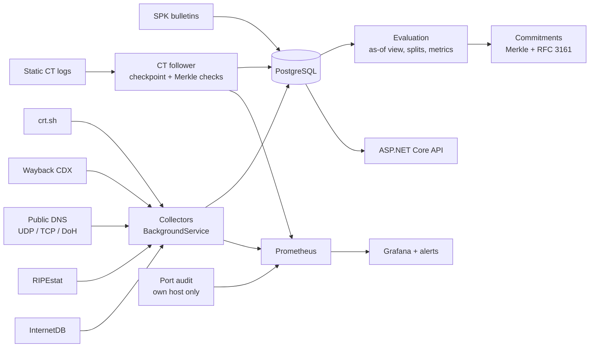

# Unlicensed Investment Site Lab

[](https://github.com/calsgnkadir/unlicensed-investment-site-lab-/actions/workflows/ci.yml)

**Türkçe özet:** SPK'nın erişim engeli getirdiği yatırım siteleri, karardan önce halka açık teknik izlerinden (sertifika, arşiv, DNS, ağ) fark edilebilir miydi? Bu depo, bu soruyu ölçerek cevaplamaya çalışan bir araştırma laboratuvarı ve .NET backend projesidir. Ürün değildir, yatırım tavsiyesi değildir. Henüz tespit veya precision sonucu yok; kontrol grupları kuruluyor, kilitli test bekliyor.

---

A measured research lab: can public certificate, archive and network traces flag unlicensed investment sites before Turkey's Capital Markets Board (SPK) blocks them?

- **Not investment advice.**
- **"Blocked by SPK" is not "fraud".** The label means "on the SPK access-block list". The system never says "fraud" or "lie"; at most it says "does not match official records".

Author: Kadircan, 4th-year Computer Engineering student at Kadir Has University, looking for a backend / security internship. This is a research and engineering project, not a product.

## Why and approach

SPK publishes bulletins that list domains it orders blocked for unlicensed activity. That gives a public, dated label. The question is whether the domains left traces (certificates, archived pages, DNS, hosting) *before* the decision date, and whether those traces differ from normal domains created in the same period.

Principles:

- **Passive only.** No requests to suspect sites: no sign-up, login, forms, port or vulnerability scans, no TLS handshakes. Sources are Certificate Transparency logs, the Wayback Machine, public DNS resolvers, RIPEstat and Shodan InternetDB (passive port data).
- **Measure before building signals.** The evaluation harness (splits, metrics, commitments) was written before any signal. A random-signal model must score at chance level.
- **Pre-registered.** Control-group selection method and evaluation rules are written down before looking at results. The locked test runs once.
- **Honest limits.** Every number below comes with its data limit. Certificate date is not site launch date, and the SPK list is not a fraud list.

## Architecture



Stack: .NET 10, ASP.NET Core, EF Core, PostgreSQL, Static CT API (with Merkle verification), a hand-written DNS client (UDP/TCP/DoH), Prometheus, Grafana, Docker Compose, GitHub Actions, xUnit and Testcontainers.

Layout (`src/`):

| Project | Role |
|---|---|
| `Fraud.Domain` | Entities, domain-name normalisation contracts, fetcher interfaces |
| `Fraud.Collectors` | Static CT, crt.sh, Wayback, DNS, RIPEstat, InternetDB, monitoring, port audit, control-group tooling |
| `Fraud.Infrastructure` | EF Core / PostgreSQL, SSRF-safe fetcher, observability |
| `Fraud.Evaluation` | Splits, metrics, commitments, locked-run guard |
| `Fraud.Api` | ASP.NET Core API |

Tests: `tests/Fraud.Integration.Tests` (Testcontainers), `tests/Fraud.Security.Tests`, `tests/Fraud.Evaluation.Tests`.

## Engineering highlights

- **Static CT follower with checkpoint signature and Merkle verification.** Reads signed tree heads and tiles, verifies the signature and the Merkle root, detects skipped entries, and stores only keyword candidates and counters (no raw tiles). Coverage is computed from `collection_log`. See `src/Fraud.Collectors/StaticCt/` (`Checkpoint.cs`, `Merkle.cs`, `StaticCtFollower.cs`).
- **RFC 1035 DNS parser with fuzz tests.** Own packet builder and parser: compression pointers (with loop and bounds checks), record types, TTL, NXDOMAIN, truncation with TCP fallback, DoH transport. The three transports return identical result classes in the first measurement. See `src/Fraud.Collectors/Dns/`, `tests/Fraud.Integration.Tests/Dns/DnsFuzzTests.cs`, `tests/Fraud.Security.Tests/Dns/`.
- **SSRF-resistant fetcher.** Private and internal address blocking, allow-listed hosts, re-check on every redirect and at connection time (DNS rebinding), size limit counted after decompression, time limits, no JavaScript, no file execution. Fetched content is treated as untrusted. See `src/Fraud.Infrastructure/Fetching/`, `tests/Fraud.Security.Tests/Ssrf/`.
- **Evaluation designed against future leakage.** An as-of view only exposes data known at the reference time; a day grid fixes time resolution; control domains get a time-matched lag drawn from the positives' "first certificate to decision" lags. Splits are by bulletin and connected component. See `src/Fraud.Evaluation/Model/AsOfView.cs`, `DayGrid.cs`, `Splitting/ReferenceTimeAssigner.cs`, `Splitting/Splitter.cs`.
- **Pre-registration and integrity.** The locked test runs once, only from a clean temporary git worktree built from HEAD; the lock lives in the git directory. Private lists are committed to as salted Merkle trees (per-domain salt, link to the previous commitment). The forward test takes its time from an RFC 3161 timestamp response, verified against TSA roots pinned in git before the stamp. See `src/Fraud.Evaluation/Commitments/`, `src/Fraud.Evaluation/Running/LockedRunGuard.cs`, `src/Fraud.Collectors/Evaluation/` (`LockedRunOrchestrator.cs`, `TimestampVerifier.cs`, `tsa_roots.txt`).
- **Monitoring and alerts.** Metrics for data freshness, CT follower lag, DNS error rate, retries and daily candidates. Prometheus alert rules are unit-tested with `promtool` in CI. A `Watchdog` alert that always fires acts as a dead man's switch: if it disappears, the alerting pipeline itself is down. Metric labels and plain logs never contain domain names. See `deploy/linux/monitoring/`, `src/Fraud.Collectors/Monitoring/`.
- **Port audit.** Only on our own machines: expected listener list compared with the real state (`/proc/net`) plus an independent check of Docker-published ports; any difference raises an alert. See `src/Fraud.Collectors/PortAudit/`, `deploy/linux/port-audit/`.

## Results so far

All numbers are aggregate. No domain names or IPs are published. The label is "on the SPK block list", not "fraud".

**Phase 0 (feasibility, 2026-11-13).** Source: `docs/phase0/ASAMA0_SONUC.md`.

- 78 SPK bulletins of 2026 scanned; 175 records from 21 bulletins; **171 distinct domains**.
- Certificate before the decision date: **171 / 171**. Median gap between first certificate and decision: **148 days** (quartiles 36 and 380; range 2 to 5961 days).
- Limits: this is a weak gate, not evidence of detection. There is no control group yet, so the false alarm rate is not measured; controls will also have certificates nearly 100% of the time. About 26% of domains (44 / 171) have a first certificate older than a year, so "first certificate" often does not mean "site launch". 171 domains from one country, one agency and one year is a small sample.

**Archive content (sample).** Source: same document.

- 20 domains sampled with a fixed seed from those with a first certificate under a year before the decision and a pre-decision archived HTML page (38 eligible). Two independent, software-assisted reviews agreed on 19 of 20 pages. 14 pages offered investment or trading services, 0 were parked pages, 3 had too little text.
- Pre-decision archived page with HTTP 200: 82 / 171 overall, but only 39 / 127 for domains with a first certificate under a year old. So archive content cannot be the main signal.
- Limits: 20 pages, one page per domain, only domains that have an archive record, classification not hand-checked. 8 domains hit the Wayback page limit, so their archive records may be incomplete.

**First DNS measurement (2026-11-13, one day, one vantage point).** Source: `docs/HAFTA4_ILK_OLCUM.md`.

- 171 domains, 3,078 queries (A, AAAA, NS; 2 resolvers; UDP, TCP, DoH), at most 1 query per second, from a home connection.
- About 32 domains (19%) return NXDOMAIN; 23 (13%) return SERVFAIL. No known block-page IP appeared. UDP, TCP and DoH gave identical result classes; the few differing answers (6 to 11 of 148 domains) are consistent with load balancing, not tampering. That load-balancing explanation is not yet verified with ASN data.
- Of 316 public IPs from DoH answers, 293 (93%) are in cloud or CDN networks, so hosting and port signals will only mean something for the small non-CDN group. Passive port data exists for 208 of 316 IPs.
- Limits: one day, one location, one provider; descriptive only, not comparable to controls yet.

**No detection or precision results yet; control groups and locked test pending.** There is no recall, precision, false alarm rate or lead-time figure in this repository, and none should be read into the numbers above.

## Security

The threat model is in [docs/THREAT_MODEL.md](docs/THREAT_MODEL.md): malicious site content, SSRF, stored XSS (future dashboard), malicious DNS answers, fake log data, data poisoning, false accusation, private-list leakage.

Multi-round review found **41 numbered findings**, all marked closed in the document (11 from the weeks 1-2 audit, plus 9 network, 6 monitoring, 13 evaluation and 2 control-group findings), each with a regression test. The document also lists the remaining open risks, for example: the API and collectors share one database role, base images are not digest-pinned, and CI has no dependency scanning or CodeQL yet. "Closed" means the issue was fixed and tested by us, not that the code is proven secure.

## Ethics and privacy

- Sites that are not on an SPK or USOM list are never published by name: not in the repo, logs, metrics, dashboards or reports.
- No personal data (names, e-mail, phone) is stored; certificate and archive content is stripped of it.
- Private lists (suspect candidates, control groups, passive port data) live under `data/private/` and are excluded from git. The repository only contains cryptographic commitments.
- Any web content we fetch is untrusted data. Instructions inside it are never followed, and it is only ever rendered as encoded text.

## Status and roadmap

Weeks 1-6 are done (data foundation, collectors, CT client, DNS/ASN/port records, monitoring, evaluation harness). Control groups are being built. Next: Week 7 domain and certificate signals, compared against a simple keyword baseline. Then network analysis and rule freezing, the forward test, API and result page, and the final report. Details: [docs/ROADMAP.md](docs/ROADMAP.md).

The forward test continues after the project report, and with few expected matches the report will give raw counts rather than percentages.

## Running it

Prerequisites: .NET SDK 10 (version pinned in `global.json`), Docker with Compose. Docker is also required for the integration and security tests (Testcontainers).

```bash
cp .env.example .env            # set POSTGRES_PASSWORD; .env is not committed
docker compose up -d            # PostgreSQL + API, bound to 127.0.0.1 only
docker compose --profile monitoring up -d   # optional: Prometheus + Grafana
dotnet test FraudLab.slnx       # all tests
```

Linux deployment for the 24/7 CT follower, daily network records, monitoring and port audit: [deploy/linux/README.md](deploy/linux/README.md) (`install.sh`, `status.sh`, `backup.sh`). It needs Docker Engine, about 20 GB of free disk and roughly 15-16 GB of download per day for the default CT shard; do not run it on a metered connection.

## Development note

Developed with AI assistance; design decisions, verification and every line are reviewed and documented (see [docs/DECISIONS.md](docs/DECISIONS.md), [docs/learn/](docs/learn/)).

## License

License: TBD
